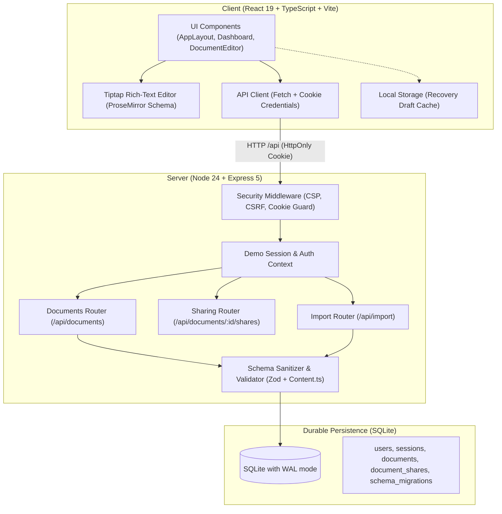

# Folio — Architecture & Engineering Tradeoffs

This document outlines the architecture, data model, security design, and deliberate scope decisions for Folio.

---

## 1. Product Slice & Guiding Principles

Folio was built to fulfill a Full Stack Product Engineer take-home assignment inspired by Google Docs. The guiding principle was **depth over surface area**: rather than attempting a shallow clone of Google Docs' entire feature set (real-time Operational Transformation, comments, presence avatars, version history, export), Folio delivers a complete, reliable end-to-end slice:

1. **Deterministic rich-text editing** with essential formatting (Headings 1-3, Bold, Italic, Underline, Bulleted List, Numbered List).
2. **Explicit, trustworthy persistence**: no false "Saved" badges; save state reflects true database durability.
3. **Safe concurrency**: revision-based conflict rejection rather than silent last-write-wins overwrites.
4. **Enforced server-side authorization**: documents owned vs. shared; strictly isolated from unauthorized users.
5. **A bounded upload mechanism**: UTF-8 `.txt` file import into a new document.

---

## 2. System Architecture & Boundaries

Folio is architected as a **modular monolith** packaged into a single Node.js service serving both the REST API and the compiled React single-page application.



### Frontend Boundary
- **Framework**: React 19 with TypeScript, bundled by Vite 8.
- **Editor Engine**: Tiptap 3 / ProseMirror. ProseMirror represents rich text as a structured JSON abstract syntax tree (AST) rather than unstructured HTML. This allows strict schema validation and prevents cross-site scripting (XSS).
- **Navigation & Routing**: React Router 7 with route blockers (`useBlocker`) to intercept navigation when unsaved changes exist.
- **Client Cache / Draft**: Local Storage acts strictly as a crash-recovery aid (`folio:draft:${docId}`). The server database remains the single source of truth.

### Backend Boundary
- **Runtime**: Node.js 24 using native ES modules.
- **Framework**: Express 5.
- **Validation**: Schema-level validation using Zod for metadata, combined with an AST recursive tree walker (`server/src/content.ts`) that enforces allowlisted nodes and marks.
- **Security Middleware**: Content Security Policy (strict script/style boundaries), Frameguard (`X-Frame-Options: DENY`), Sec-Fetch-Site and Origin verification to protect against CSRF attacks.

### Storage Boundary
- **Engine**: SQLite via Node.js 24's native `node:sqlite` (`DatabaseSync`).
- **Configuration**:
  - `PRAGMA foreign_keys = ON;` (relational integrity)
  - `PRAGMA journal_mode = WAL;` (high concurrency with concurrent readers and single writer)
  - `PRAGMA busy_timeout = 5000;` (locks gracefully wait up to 5s under load)
  - `STRICT` table definitions ensuring type safety at the storage layer.

---

## 3. Data Model

The schema uses four core relational tables:

```sql
CREATE TABLE users (
  id TEXT PRIMARY KEY,
  name TEXT NOT NULL,
  email TEXT NOT NULL UNIQUE,
  color TEXT NOT NULL,
  role_label TEXT NOT NULL DEFAULT '',
  created_at TEXT NOT NULL
) STRICT;

CREATE TABLE sessions (
  token_hash TEXT PRIMARY KEY,
  user_id TEXT NOT NULL REFERENCES users(id) ON DELETE CASCADE,
  created_at TEXT NOT NULL,
  expires_at TEXT NOT NULL
) STRICT;

CREATE TABLE documents (
  id TEXT PRIMARY KEY,
  title TEXT NOT NULL,
  content_json TEXT NOT NULL,
  plain_text TEXT NOT NULL DEFAULT '',
  owner_id TEXT NOT NULL REFERENCES users(id) ON DELETE CASCADE,
  revision INTEGER NOT NULL DEFAULT 1 CHECK (revision >= 1),
  created_at TEXT NOT NULL,
  updated_at TEXT NOT NULL,
  updated_by TEXT NOT NULL REFERENCES users(id)
) STRICT;

CREATE TABLE document_shares (
  document_id TEXT NOT NULL REFERENCES documents(id) ON DELETE CASCADE,
  user_id TEXT NOT NULL REFERENCES users(id) ON DELETE CASCADE,
  role TEXT NOT NULL DEFAULT 'editor' CHECK (role IN ('editor', 'viewer')),
  created_at TEXT NOT NULL,
  PRIMARY KEY (document_id, user_id)
) STRICT;
```

### Schema Rationale
- **Structured Content**: `content_json` stores the validated ProseMirror AST. Storing AST rather than HTML preserves exact formatting nodes across platforms without HTML sanitization discrepancies.
- **Searchable Plain Text**: `plain_text` is extracted automatically on save, enabling fast snippet generation and search indexing without deserializing JSON.
- **Revision Counter**: `revision` increments monotonically on every save. This powers optimistic concurrency control.
- **Idempotent Shares**: `document_shares` enforces a composite primary key `(document_id, user_id)` preventing duplicate share records.

---

## 4. Access Control & Authorization Model

Security is enforced strictly on the server:

| Action | Document Owner | Shared Editor (`role: editor`) | Shared Viewer (`role: viewer`) | Unrelated User |
| :--- | :---: | :---: | :---: | :---: |
| **List Documents** | Appears under *My documents* | Appears under *Shared with me* | Appears under *Shared with me* | Completely omitted |
| **Read Document** | `200 OK` | `200 OK` | `200 OK` | `404 Not Found` |
| **Edit / Rename** | `200 OK` (increments rev) | `200 OK` (increments rev) | `403 Forbidden` | `404 Not Found` |
| **Manage Sharing** | `200 OK` (grant / revoke) | `403 Forbidden` | `403 Forbidden` | `404 Not Found` |
| **Delete Document** | `200 OK` | `403 Forbidden` | `403 Forbidden` | `404 Not Found` |

### Information Hiding (404 vs 403)
When an unrelated user attempts to read, edit, or share a document they do not have access to, the server responds with **`404 Not Found`**, not `403 Forbidden`. This prevents document enumeration and ID probing. `403 Forbidden` is reserved exclusively for authenticated collaborators attempting unauthorized operations on documents they can already view (e.g., a shared editor attempting to modify share permissions).

### Demo Identity Mechanism
To allow reviewers to test user switching immediately without email verification or OAuth secrets, Folio implements a **demo session endpoint** (`POST /api/demo-session`). The endpoint sets an `HttpOnly`, `SameSite=Lax` cookie storing a cryptographically random session token (hashed with SHA-256 in the database). Client requests never pass an `ownerId` or user token in request bodies; identity is always derived server-side from the verified cookie.

---

## 5. Saving, Revisions & Conflict Handling

### Why Explicit Save Was Chosen Over Unchecked Autosave
A common failure mode in collaborative editor take-homes is building a naive autosave debounce that continuously overwrites the database with last-write-wins semantics. In a multi-user environment, this causes catastrophic data loss when two users edit the same document simultaneously.

Folio chooses **explicit, revision-checked saving**:
1. When User A opens a document at revision 2, their client holds `baseRevision: 2`.
2. When User A saves (`Cmd/Ctrl+S` or clicking "Save"), the server executes:
   ```sql
   UPDATE documents
   SET title = ?, content_json = ?, revision = revision + 1, updated_at = ?, updated_by = ?
   WHERE id = ? AND revision = ?;
   ```
3. If User B saved in the meantime, the current revision in the database is 3. The `UPDATE` matches 0 rows.
4. The server responds with **`409 Conflict`** and returns the latest document state in the error details.
5. User A's editor transitions into a clear **"Update conflict"** state. User A is given two safe options:
   - **Save as Copy**: Creates a new document titled `"[Original Title] (my copy)"` containing their edits, preserving their work with zero data loss.
   - **Reload Latest**: Discards their conflicting changes and loads User B's latest version after a user confirmation prompt.

---

## 6. File Upload / Import Design

### Selected Choice: UTF-8 `.txt` Import into a New Document
The assignment asked for at least one bounded upload mechanism. Folio implements UTF-8 `.txt` file import:

- **Reasoning**: Plain text import is clean, predictable, and directly aligns with the core document creation flow.
- **Constraints**:
  - Size limited to 200 KB (~4,000 lines), communicated prominently in the UI.
  - Strictly requires the `.txt` extension and valid UTF-8 text encoding (rejecting binary files or null control bytes).
  - Sanitizes filenames against path traversal (e.g. `../../secret.txt` becomes `secret`).
  - Creates a **new document** rather than overwriting an active draft.

---

## 7. Tradeoffs & Deliberate Scope Cuts

To maintain high engineering quality within the time budget, several features were deliberately omitted:

1. **Real-time Synchronous Operational Transformation / CRDTs (Yjs / Automerge)**:
   - *Why cut*: Implementing robust peer-to-peer or server-mediated CRDTs requires complex WebSocket infrastructure, presence management, and network partition reconciliation. For a take-home, optimistic revision-checked REST persistence is dramatically more reliable, testable, and maintainable.
2. **Arbitrary File Attachments / Blob Storage**:
   - *Why cut*: Supporting binary attachments requires either S3-compatible object storage (which reviewer environments may not possess) or local filesystem disk storage with complex permission checks. UTF-8 `.txt` import fulfilled the upload requirement with zero external storage dependencies.
3. **Complex Role Hierarchies**:
   - *Why cut*: The product brief called for a clear owner vs. shared recipient distinction. Folio implements two clean roles: `owner` (full control) and `editor` (content editing). Roles like `commenter` or `billing admin` were omitted as unnecessary scope bloat.
4. **Third-Party OAuth / Passwords**:
   - *Why cut*: Requiring reviewers to register real accounts or configure OAuth app secrets adds unnecessary friction. Pre-seeded demo accounts with HttpOnly cookies demonstrate identical server-side session authorization without setup hurdles.
